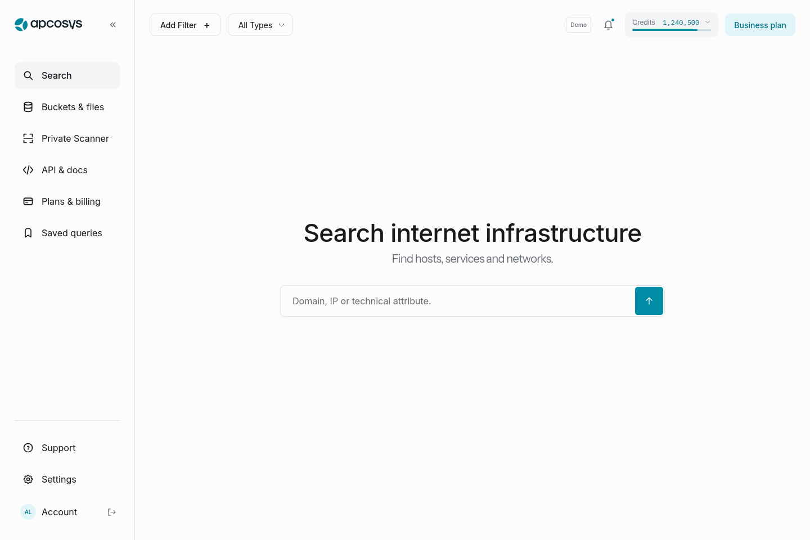

# APCOSYS — доработка удобства и готовность интерфейса

Дата: 23 октября 2026. Сравнительная база: `83b2a3a20ca5d81b1b8f232d6351ce2bf5c4455c`.

## Результат

Выполнен повторный функциональный и визуальный проход по приложению с восстановлением требований из исследований 19–22 октября. Исправлены все 14 конкретных разрывов UX-01…UX-14, перечисленных в [матрице источников и сценариев](2026-10-23-scenario-coverage.md), и дополнительные ошибки, найденные браузерными проверками. Изменения включают рабочий интерфейс и регрессионные тесты.

**Статус:** клиент и явно обозначенная демонстрационная версия проверены. Для промышленной сдачи всего сервиса остаётся приёмка с настоящими HTTP/WS backend, аккаунтами клиента и внешними провайдерами. Этот отчёт не объявляет проверенными 3868 исторических комбинаций из исходных исследований: в источнике они помечены NOT_RUN.

## Поиск и визуальная система

Сохранена согласованная стартовая композиция: свободная центральная область, крупный заголовок, одна строка поиска, спокойная навигация и акцент на основном действии. Тема, плотность, размер текста и уменьшение анимации находятся в **Settings**. В левом меню нет отдельных пунктов Light / Dark / System.

Компоновка рабочих страниц учитывает ширину доступной области, а не только окна. Боковое меню и увеличение текста больше не сжимают карточки тарифов, данные хоста и сортировку до нечитаемых колонок. На мобильном экране шкала кредитов остаётся доступной; короткая запись `1.2M` раскрывается в точное значение.

Добавлены короткие переходы hover/focus/selection, отклик основных кнопок, появление страницы и уведомлений, плавное изменение шкалы. Они отключаются через системный `prefers-reduced-motion` и настройку приложения. Большие списки не анимируются поэлементно. Ввод на сенсорном устройстве использует шрифт не меньше 16 px, основные действия — область нажатия от 44 px.

## Что исправлено по разделам

| Раздел | Новое поведение | Проверка |
|---|---|---|
| Токены / кредиты | Кликабельная шкала открывает точные поисковые, scan и purchased balances, план, период и переход к пакетам. Unknown не превращается в ноль; full_access не выдаётся за отсутствие доступа. Purchased не прибавляется повторно. | Unit + browser: неизвестный, нулевой, выше allocation, full_access, refresh, 8 ширин |
| Поиск | Переключение типа не применяет незавершённые условия. Фасеты поддерживают несколько значений через OR внутри поля и AND между полями; есть Apply/Cancel и выбранное состояние. | Сценарии редактора и фасетов, сохранение сложных условий |
| Расход запросов | Пагинация, сортировка и количество строк используют кеш аналитики. Скрытая мобильная аналитика загружается только при открытии. | Mock WS: 4 hosts-запроса и 1 analytics; 0 analytics до открытия мобильной панели |
| Возврат к выдаче | Browser Back и Back to results возвращают точный исходный URL, запрос, фильтры, страницу и позицию. Устранён сдвиг на 40 px из-за переноса toolbar после mount. | Обе формы возврата с неканоническим URL, допуск scroll меньше 3 px |
| Карточка хоста | URL определяет выбранный сервис и его локальную страницу. На узком экране есть возврат из деталей к списку. Вкладки и сервисы не сбрасывают desktop scroll. | Сервис 10999 среди 1000, keyboard/mobile, same-path REPLACE |
| Большие ответы | Exposed data и вложенные массивы показываются страницами по 50 записей без потери остальных данных. Missing, null, пустая строка, 0 и false различаются. | 10 000 строк: ограниченный DOM, следующая страница, один hostinfo |
| Scanner | Мобильные карточки с видимыми Edit/Delete/Results; подробные даты в диалоге. CSV без заголовка сохраняет первый адрес, корректно определяет кавычки и разделители, сообщает дубли. | Импорт → дедупликация → review 1000 портов; узкий экран; цепочка вложенных диалогов |
| Files / Export | Back/Forward восстанавливают соответствующий кеш без платного повтора. Есть применение внизу длинных фильтров. Пока открыт системный выбор файла, опции экспорта заблокированы; отмена и уход со страницы корректны. | История и неизменный баланс, NDJSON, успешная запись, ошибка диска, отмена picker |
| Вход и аккаунт | Return context сохраняется для подразделов, гостя, 202/2FA, legacy login, next и navigation state. OTP с пробелами сохраняет ведущий ноль. Account tabs сохраняют keyboard focus. | 8 браузерных маршрутов, включая последовательные Arrow/Home/End |
| Профиль / команда | Пустые значения и известные дубли не отправляются. После неопределённого подтверждения профиля можно проверить текущее состояние. Повреждённый список сессий получает локальную ошибку. | Auth state tests, чтение контрактов, соответствующие browser routes |
| Billing | План, период и пакет сохраняются до входа и возвращаются в review. Новый intent очищает старые checkout/invoice/promo поля; unknown/pending нельзя обойти сменой URL. Автопокупки нет. | 3 mock HTTP/WS маршрута, включая Back после явно созданного mock checkout |
| Notifications | Повреждённые даты, типы, счётчики и отдельные записи не роняют страницу. Partial/empty/error различаются; обновление сохраняет текущие записи. Team member added соответствует операции, а unknown read state не выглядит как unread. | Нормализатор, mark-read browser test, axe |
| Общая навигация | AppShell сохраняется между маршрутами. Закрытое мобильное меню исключено из Tab-порядка; открытое изолирует фон. Общая блокировка скролла поддерживает вложенные диалоги и возврат фокуса. `/` и Ctrl/⌘K переводят к поиску. | Landscape 667 × 375, Escape, focus containment, shortcuts, nested dialogs |

## Адаптивность и визуальное подтверждение

**17 основных маршрутов** проверены на 1440, 390 и 320 px: видимый заголовок, загруженные изображения, отсутствие горизонтального переполнения документа и необработанных page errors. Дополнительно:

- шкала и диалог кредитов: 280, 320, 390, 540, 768, 1024, 1440 и 1920 px при размере текста 125%;
- поиск и карточка с 1000 сервисами: 320, 540, 820 и 1024 px при 125%;
- billing, team, создание scan, files и settings: 820, 1024 и 1280 px, тёмная тема, compact, 125%;
- меню и диалог выхода: 667 × 375, достижимость нижних действий, отсутствие оставшейся блокировки прокрутки;
- точечные axe WCAG 2 A/AA и 2.1 AA: 7 страниц плюс диалоги криптотранзакций и кредитов — без найденных нарушений в проверенных состояниях. Это не сертификация всех состояний приложения.

Снимки сняты с работающего локального приложения в окончательном общем прогоне, без ретуши. На них синтетические данные demo adapter. Просмотрены сами изображения, а не только DOM-размеры.

| Состояние | Снимок |
|---|---|
| Старт поиска, 390 px | [search-mobile.png](screenshots/search-mobile.png) |
| Кредиты, 320 px / 125% | [credits-mobile-large-text.png](screenshots/credits-mobile-large-text.png) |
| Выдача, 320 px / 125% | [results-mobile-large-text.png](screenshots/results-mobile-large-text.png) |
| Scanner cards, 320 px | [scanner-mobile.png](screenshots/scanner-mobile.png) |
| Billing, 820 px / dark / 125% | [billing-tablet-dark-large-text.png](screenshots/billing-tablet-dark-large-text.png) |

## Производительность

Маршруты аккаунта, биллинга, сканера, файлов, настроек и карточки хоста загружаются отдельными JavaScript-частями. Поиск и оболочка остаются готовы сразу. Общая навигация больше не пересоздаётся при каждом переходе; ошибка отдельного экрана оставляет меню доступным.

Фактическая стартовая группа production/demo сборки — около **448 kB JavaScript до сжатия**, сумма gzip частей около **141 kB**; начальный CSS — около **56 kB**. Подсчёт включает entry и все modulepreload из `dist/index.html`, а не только уменьшившийся entry. Шрифты и позднее загружаемые маршруты считаются отдельно. Это размер артефактов сборки, а не обещание времени загрузки на устройстве клиента.

Долгий export обновляет счётчик интерфейса максимум 10 раз в секунду и сохраняет точный финальный объём. Массивы по 10 000 строк не монтируются целиком. Повторные analytics-запросы, ненужные для отображения страницы, устранены.

## Повторяемые проверки

| Команда / прогон | Результат | Граница утверждения |
|---|---|---|
| `npm test` | **93/93 PASS**, 11 файлов | Transport, demo, auth, query/data models, CSV, export, credits, notifications |
| `npm run typecheck` | PASS | Приложение и тесты |
| `npm run build` | PASS | Сборка с live default |
| `npm run build:demo` | PASS | Публикуемая явно обозначенная demo сборка |
| Полная Firefox suite | **54/54 PASS**, 1,6 минуты, retries=0 | Полный набор на момент старта общего прогона |
| Дополненный Billing return suite | **3/3 PASS** | Два уже включённых сценария + одна новая history-regression; итого **55 уникальных E2E** проверены |
| `git diff --check` | PASS | Отсутствуют whitespace errors |

Все браузерные проверки выполняются на локальном приложении с demo adapter либо явно подменёнными HTTP/WS ответами. Auth и billing tests не используют реальные учётные данные, не отправляют почту и не создают настоящие платежи. CI запускает тот же набор на Google Chrome и отдельную проверку контейнера/proxy; результат опубликован в [Actions](https://github.com/IMONsergey/Assaasdev/actions).

Размеры артефактов, SHA-256 исходников и выбранных снимков зафиксированы в [verification-current.json](verification-current.json).

## Что требуется для промышленной приёмки

Нужно подключить реальные HTTP/WS origins и пройти сценарии на test identities Free / Plus / Expert / Business, owner/member/guest. Проверить сессии и cookie/Origin, внешние email/OAuth/Telegram, sandbox payment → entitlement, приватные ACL и ограниченные ссылки, фактическую стоимость и расписание сканера, серверный экспорт и его восстановление.

В этой итерации такие внешние зависимости не выданы за работающие интеграции. Публичная версия остаётся Demo: её можно использовать для приёмки интерфейса и сценариев клиента. Реальные операции готовы к подключению через существующий website API; замена backend, базы данных или платёжного провайдера не требуется.
