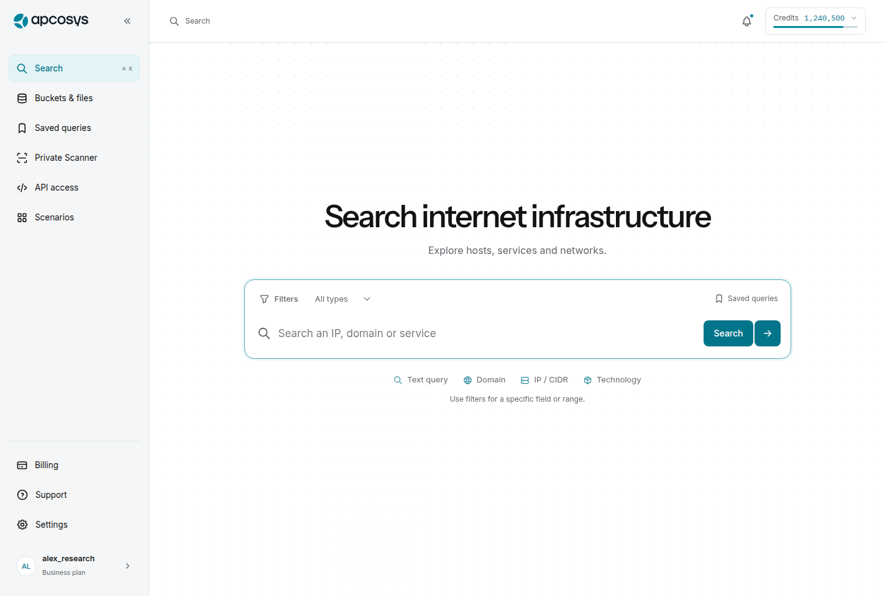
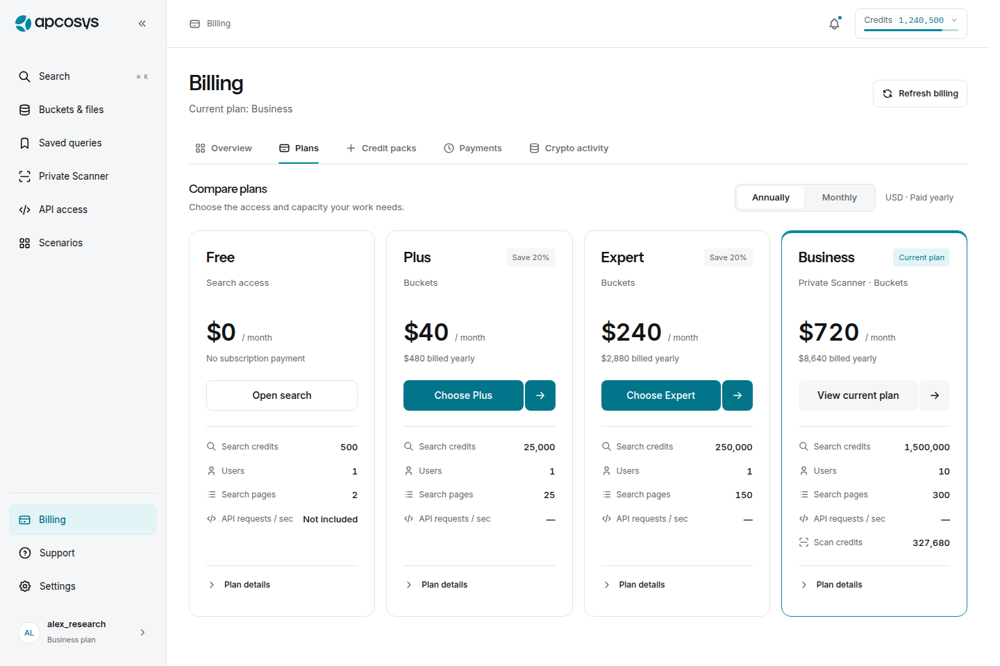
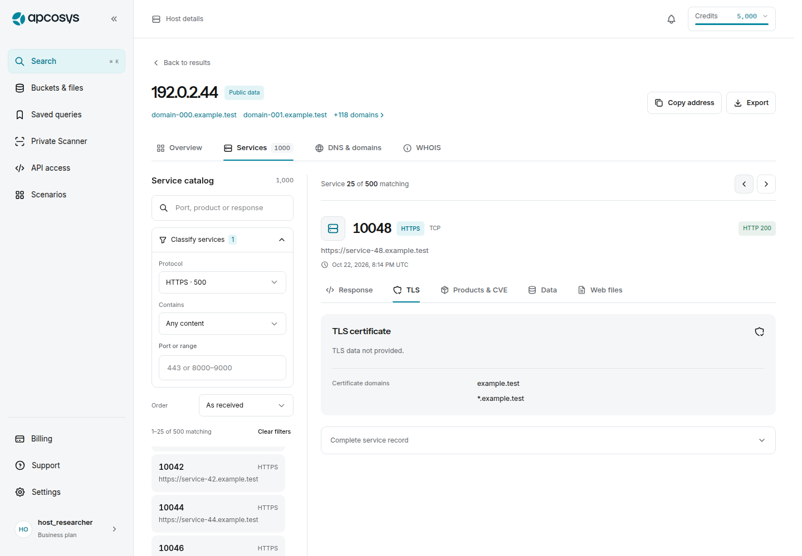
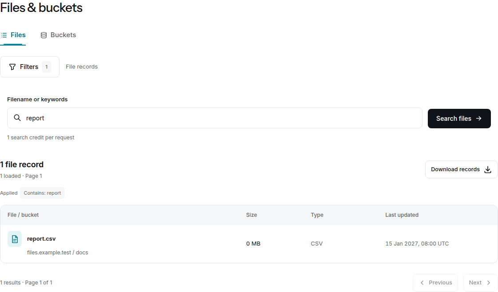

# APCOSYS — доработка интерфейса по 11 скриншотам

Дата: 24 октября 2026 года.

Этот документ связывает замечания клиента с изменениями интерфейса и конкретными действиями для приёмки. В проход вошли общий каркас приложения, поиск, сохранённые запросы, большие карточки хостов, файлы, тарифы, поддержка и юридические документы. Номера ниже соответствуют порядку 11 присланных скриншотов; время позволяет найти исходный файл.

Статус «изменено» описывает реализованное поведение. Итог полного набора тестов фиксируется отдельно в разделе «Финальная проверка». Снимки и проверки локального фронтенда не подтверждают работу настоящих платежей, сканирования или внешних провайдеров.

## 1. Матрица замечаний клиента

| Скриншот | Замечание | Что изменено | Что проверить при приёмке |
| --- | --- | --- | --- |
| **1 · 08:58:15** | Первый экран поиска мелковат; нужен крупный заголовок и фирменный фон | Увеличены заголовок и основной поисковый блок. Подключена интерактивная сетка точек APCOSYS; основной ввод остаётся визуальным центром | Открыть `/search` на широком экране и при 320 px; проверить чтение заголовка, ввод, движение указателя и уменьшенную анимацию |
| **2 · 08:59:09** | Вернуть полезные ориентиры под поиском | Добавлены Text query, Domain, IP / CIDR и Technology с иконками, затем короткая подсказка о точном поле или диапазоне | Убедиться, что ориентиры видны до первого запроса, переносятся на мобильном экране и не выглядят как дополнительные обязательные поля |
| **3 · 09:04:05** | Грубая рамка фокуса и неудачная кнопка запуска | Фокус получает вся поисковая поверхность без второй рамки внутри input. Кнопка Search использует адаптированную двойную конструкцию из библиотеки; при реальном ожидании появляется OrbCube | Пройти Tab → ввод → Enter, затем повторить мышью и касанием; фокус заметен, геометрия не скачет, запуск имеет понятный результат |
| **4 · 09:04:48** | Фильтры и тип должны быть слева сверху; панель должна открываться внутри рабочей области | Controls перенесены над строкой поиска. Панели фильтров поиска и файлов ограничены областью после sidebar и header. Пересобраны заголовки групп, отступы, действия Apply/Cancel/Reset | Изменить несколько условий, отменить, открыть снова и применить; проверить прокрутку длинной панели, Escape и доступность нижних действий на узком экране |
| **5 · 09:06:32** | Стрелки select прижаты к краю; каталог сервисов и детали выглядят тесно | У select единая линейная стрелка и зарезервированное место справа. Каталог сервисов расширен; фильтры, список и выбранное наблюдение разделены. Добавлена навигация между совпавшими сервисами | В хосте с большим числом сервисов выбрать протокол, перейти через границу страницы и вернуться; состояние фильтров, вложенной вкладки и выбранного сервиса сохраняется |
| **6 · 09:09:59** | Разрозненные ширины страниц; слабая структура Saved queries | Страницы используют общий максимум ширины. Сохранённые запросы оформлены читаемыми карточками, добавлен локальный поиск; действие сохранения зависит от наличия текущего запроса | Найти запрос по тексту, открыть Query details, перейти в результат и вернуться; пустая выдача поиска по карточкам имеет действие очистки |
| **7 · 09:12:23** | Неровный крестик и пропорции модальных окон, чрезмерный фокус | Общая кнопка закрытия имеет квадратную область 40 × 40 px. Заголовок, содержимое и footer диалогов используют единый ритм. Уведомления сохраняют доступность внутри активного модального окна | Открыть Credits & usage, пройти клавиатурой, закрыть Escape и крестиком. В диалоге поддержки скопировать текст и закрыть уведомление: сам диалог должен остаться открытым |
| **8 · 09:13:08** | В Support нужна форма обращения | В Help & support добавлено Contact support: тема, имя, email, сообщение, проверка заполнения и просмотр подготовленного письма | Подготовить обращение, проверить адресата и текст, закрыть и открыть форму. Copy message работает отдельно от открытия почтового приложения; ложного статуса «отправлено» нет |
| **9 · 09:14:12** | Кривая сетка API Usage & limits, неравноценные блоки | Search credits и Scan credits имеют согласованную структуру. Ниже расположен общий блок лимитов; на мобильном экране колонки переходят в одну. Значения и доли берутся из доступных данных | Сравнить обе карточки, увеличить текст, проверить 320 px и недоступную величину allocation: неизвестное значение не превращается в выдуманный процент |
| **10 · 09:14:46** | Цена в кнопке вместо нормальной карточки покупки | Цена и объём кредитов выделены в карточке; действие называется Buy credits. В тарифах годовой период выбран по умолчанию, месячный доступен переключением. Изменение суммы использует фирменную анимацию цифр | Переключить Annual/Monthly, открыть review тарифа и пакета. Месячный эквивалент и фактическая годовая сумма различимы; выбор карточки ещё не создаёт платёж |
| **11 · 09:17:08** | Простые треугольники раскрытия и нечитаемый сырой код | Раскрытия используют линейные chevron. CodeCanvas показывает подсветку, номера строк, перенос, копирование и ограниченное окно длинного источника | Открыть полный host/service record, JSON сохранённого запроса и пример API. Перейти на далёкую страницу длинного источника; Copy должен возвращать весь исходный текст |

## 2. Общая структура и визуальные правила

Основная навигация объединена: разделители Explore / Workspace убраны. Search, Buckets & files, Saved queries, Private Scanner, API access и Scenarios доступны из одной группы; Billing, Support и Settings остаются постоянными точками входа. Выход из аккаунта находится в настройках профиля. Рабочие разделы используют собственные вкладки вместо накопления всех действий на одном экране.

Общие правила заданы в [interface-system.css](../../src/styles/interface-system.css): максимум страницы **1440 px**, базовый межблочный интервал **24 px**, внутренний отступ карточки **24 px**, основной control **44 px**. На мобильном экране интервалы и поля уменьшаются согласованно; широкие таблицы прокручиваются в собственной области. Закреплённый header остаётся ориентиром, а заголовок выбранного сервиса учитывает его высоту.

Для фокуса, кнопок закрытия, select и раскрывающихся блоков используются общие правила. Короткие подтверждения и ошибки действия показываются уведомлениями; состояния, требующие решения пользователя, остаются рядом с соответствующей операцией. В частности, неизвестный исход платежа или изменения аккаунта нельзя спрятать в исчезающее сообщение. Уведомление при наведении или фокусе не исчезает, а при открытом modal размещается в его интерактивном контексте. Смена этого контекста сохраняет оставшееся время уведомления. Реализация: [ToastMessage](../../src/components/ToastMessage.tsx), [ToastRegion](../../src/components/ToastRegion.tsx).

Иконки, наблюдаемые технологии и флаги добавляют визуальные ориентиры. Флаг выбирается по переданному ISO-коду или распознанному названию страны. Используются локальные SVG из [flag-icons](../../public/assets/flags/README.md), чтобы отображение не зависело от emoji-шрифта системы. Загружаются только флаги, видимые в данных; неизвестная страна остаётся текстом без выдуманного изображения. Локальные официальные изображения NGINX, Apache и PostgreSQL имеют [список источников](../../public/assets/technologies/README.md); неизвестная технология получает нейтральную иконку.

## 3. Фирменные компоненты и их происхождение

Использован исходный код пользовательской библиотеки **Apco-components-lib**, зафиксированный на коммите [`4f3769b4be2ab7eeecb8f8dc4b5b2aa84360e665`](https://github.com/IMONsergey/Apco-components-lib/tree/4f3769b4be2ab7eeecb8f8dc4b5b2aa84360e665). Адаптация и границы описаны в [локальном README компонентов](../../src/components/brand/README.md).

| Компонент | Каталог клиента | Зафиксированный исходник | Применение в SaaS |
| --- | --- | --- | --- |
| Сетка точек | [dots](https://imonsergey.github.io/Apco-components-lib/#components/dots) | [DotCascade.tsx](https://github.com/IMONsergey/Apco-components-lib/blob/4f3769b4be2ab7eeecb8f8dc4b5b2aa84360e665/src/visuals/dots/DotCascade.tsx), [dot-cascade-themed.js](https://github.com/IMONsergey/Apco-components-lib/blob/4f3769b4be2ab7eeecb8f8dc4b5b2aa84360e665/src/visuals/dots/dot-cascade-themed.js), [dot-cascade.css](https://github.com/IMONsergey/Apco-components-lib/blob/4f3769b4be2ab7eeecb8f8dc4b5b2aa84360e665/src/visuals/dots/dot-cascade.css) | Фон первого экрана, реакция на указатель, цвета темы; после успокоения анимация не перерисовывается непрерывно |
| Загрузка | [orb-cube](https://imonsergey.github.io/Apco-components-lib/#components/orb-cube) | [OrbCubeLoader.tsx](https://github.com/IMONsergey/Apco-components-lib/blob/4f3769b4be2ab7eeecb8f8dc4b5b2aa84360e665/src/visuals/uploads/orb-cube/OrbCubeLoader.tsx), [OrbCubeLoader.css](https://github.com/IMONsergey/Apco-components-lib/blob/4f3769b4be2ab7eeecb8f8dc4b5b2aa84360e665/src/visuals/uploads/orb-cube/OrbCubeLoader.css) | Ожидание реальных операций, loading-кнопки и skeleton-состояния |
| Цена | [price](https://imonsergey.github.io/Apco-components-lib/#components/price) | [AnimatedPrice.tsx](https://github.com/IMONsergey/Apco-components-lib/blob/4f3769b4be2ab7eeecb8f8dc4b5b2aa84360e665/src/components/ui/AnimatedPrice.tsx) | Плавная смена цифр; доступное значение обновляется сразу, дробная сумма сохраняется |
| Двойная кнопка | [button](https://imonsergey.github.io/Apco-components-lib/#components/button) | [DoubleButton.tsx](https://github.com/IMONsergey/Apco-components-lib/blob/4f3769b4be2ab7eeecb8f8dc4b5b2aa84360e665/src/components/ui/DoubleButton.tsx), [BillingSwitch.tsx](https://github.com/IMONsergey/Apco-components-lib/blob/4f3769b4be2ab7eeecb8f8dc4b5b2aa84360e665/src/components/ui/BillingSwitch.tsx) | Search и действия в биллинге; визуально составная форма остаётся одной кнопкой и одной остановкой Tab |

Анимации учитывают системное `prefers-reduced-motion` и настройку приложения. Canvas приостанавливается вне видимой области и в фоновой вкладке. Быстрое повторное переключение цены прерывает предыдущий переход; оно не меняет платёжную сумму. Явная ссылка на месячный тариф и ранее выбранный период оплаты имеют приоритет над годовым значением по умолчанию.

## 4. Поиск и большие массивы данных

**Подсказки поиска.** После короткой задержки запрашиваются значения документированным методом autocomplete. Кэш разделён по пользователю и тексту; результаты прежнего текста не показываются для нового ввода. Стрелки выбирают вариант, Enter подтверждает, Escape закрывает список; поддерживается касание. Значение поля открывает редактируемый фильтр. Ввод и выбор фильтра не вызывают hosts или analytics: пользователь отдельно применяет условия. Аналитика по-прежнему загружается явным действием. [SearchAutocomplete](../../src/features/search/SearchAutocomplete.tsx)

**Черновик и результат.** Apply, Cancel, тип, chips, public/private scope и возврат к результатам сохраняют различие между редактируемым запросом и уже выполненным. Прямая ссылка `conditions=1` сохраняет намерение открыть фильтры до завершения загрузки сессии; смена состояния loading → authenticated больше не закрывает панель после удаления параметра из URL.

**Выдача и карточка хоста.** Строки результатов имеют ясную последовательность адрес → организация → сервисы → география → наблюдение. По содержательной области строки можно открыть хост; ссылки портов сохраняют собственное действие. Внутри хоста Overview, Services, DNS & domains и WHOIS отделены друг от друга. Services содержит каталог и вкладки Response, TLS, Products & CVE, Data и Web files.

**Тысячи сервисов.** Каталог фильтруется по тексту, протоколу, типу содержимого и порту/диапазону. Локальная страница содержит 25 сервисов; доступны сортировка, прямой переход на страницу и previous/next по всему отфильтрованному списку. На мобильном экране список и детали показываются последовательно; Back to service list возвращает сохранённый контекст. Переключения между уже полученными данными не запрашивают хост повторно.

**Тысячи строк.** Data explorer ищет и сортирует все полученные строки, но монтирует 25/50/100 строк за раз. Выбор колонок и состояние просмотра сохраняются в области текущего пользователя/сервиса. Строка открывает инспектор всех исходных полей; отдельная кнопка оставляет это действие доступным с клавиатуры. Тестовая выборка включает 10 000 строк. Полученное количество не объявляется полным размером серверного набора без соответствующих данных.

**Длинные исходники.** [CodeCanvas](../../src/components/CodeCanvas.tsx) выводит JSON, HTTP, HTML, команды и обычный текст через безопасные текстовые узлы React. Окно ограничено 24 000 символами / 160 строками; есть номера строк, перенос, paging и прямой переход. Copy получает весь исходный текст. Проверочный host record объёмом около 2 MB открывается без монтажа всего источника в DOM. Ноль, false, пустой ответ и отсутствующее значение остаются различимыми.

## 5. Каталог из 46 сценариев

Страница `/scenarios` содержит поиск, категории, карточки и предварительный список шагов. Первые 38 сценариев связаны с исходными семействами приёмки AC-01…AC-38; восемь дополнительных открывают поддержку, legal, сохранённые запросы, уведомления, экспорт файлов, пакеты кредитов, регистрацию и восстановление пароля.

| Категория | Сценариев |
| --- | ---: |
| Search & analytics | 11 |
| Host investigation | 8 |
| Files & exports | 5 |
| Private Scanner | 4 |
| Account & security | 7 |
| Billing & credits | 5 |
| Workspace | 6 |
| **Всего** | **46** |

Пошаговая панель работает в настоящих разделах интерфейса: её можно свернуть, закрыть, пройти вперёд или вернуться. Она использует выбранный пользователем хост и текущий query/task scope. Если хост ещё не выбран, пользователь получает соответствующий шаг. Начало сценария само не выполняет поиск, сканирование или платёж. В session storage сохраняются только идентификатор сценария и прогресс; результаты и тексты запросов туда не записываются.

Число карточек означает размер каталога инструкций. Завершение инструкции не является доказательством успешной внешней операции или отдельным пройденным backend-тестом. Подробности и отдельные снимки: [guided workflows](2026-10-24-guided-workflows.md).

## 6. Поддержка, документы и границы интеграции

Support подготавливает письмо на **info@apcosys.net** с точным preview перед открытием почтовой программы. В текущем API нет метода создания support ticket; поэтому интерфейс не выдумывает номер обращения и не утверждает, что письмо доставлено. Адрес и подход сверены с существующим маркетинговым сайтом; происхождение записано в [аудите поддержки](2026-10-24-guided-workflows.md#support-request).

В Settings → Legal собраны шесть опубликованных адресов: [Terms & Conditions](https://apcosys.net/legal/terms), [Privacy Policy](https://apcosys.net/legal/privacy-policy), [API & Data License Agreement](https://apcosys.net/legal/api-data-license-agreement), [Data Processing Agreement](https://apcosys.net/legal/data-processing-agreement), [Data Collection Policy](https://apcosys.net/legal/data-collection-policy), [Cookie Policy](https://apcosys.net/legal/cookie-policy). Содержимое договоров не заменялось сгенерированными текстами. Проверка frontend-ссылок не удостоверяет доступность и юридическую актуальность удалённых документов; при проверке веб-инструмент не смог получить содержимое всех шести страниц.

| Область | Что готово во фронтенде | Что требует реального окружения |
| --- | --- | --- |
| Данные и доступ | HTTP/WS contract, состояния доступа, сохранение query scope, раздельные loading/error/empty состояния | Реальные ответы, ACL, полнота данных, списание и лимиты на клиентском backend |
| Платежи и подписки | Сравнение, выбор периода, review, явный запуск операции, проверка неизвестного исхода | Провайдер оплаты, callback, подтверждение платежа и начисление прав/кредитов |
| Private Scanner и экспорт | Маршруты создания/просмотра, фильтрация, состояния задач и скачивания | Реальный запуск скана, стоимость, расписания, private ACL и восстановление потока экспорта |
| Вход и аккаунт | Формы, pending 2FA, возврат после входа, подтверждения изменений | Cookie/Origin/CORS, доставка email, OAuth/Telegram, реальные TOTP и recovery |
| Поддержка и Legal | Подготовка проверяемого письма, копирование, ссылки на официальные документы | Отправка из почтового приложения и доступность опубликованных документов |

Визуальные метки Demo и служебные подсказки убраны из пользовательского каркаса. Это не меняет источник данных публичной review-сборки: она по-прежнему использует локальный адаптер, а не клиентский production backend. Production-интеграция принимается по отдельным критериям в [API integration](../API-INTEGRATION.md) и [Deployment](../DEPLOYMENT.md).

## 7. Проверенные визуальные примеры

Ниже — неизменённые PNG из локального статического браузерного прохода этой итерации. Host использует контролируемые данные из 1000 сервисов, Files — подменённый ответ API. Это доказательства отображения и навигации, а не снимки реального клиентского аккаунта. Снимки обновлены из финального общего прогона, включая исправления уведомлений, прямых ссылок на фильтры и контраста.

### Главный поиск, подсказки и фильтры

[Мобильный экран](2026-10-24-client-polish/search-home-mobile.png) · [Подсказки](2026-10-24-client-polish/search-suggestions-desktop.png) · [Фильтры внутри рабочей области](2026-10-24-client-polish/search-filters-desktop.png) · [Фильтры на телефоне](2026-10-24-client-polish/search-filters-mobile.png) · [Результаты](2026-10-24-client-polish/search-results-desktop.png).

### Тарифы и пакеты

[Карточки пакетов](2026-10-24-client-polish/billing-packs-desktop.png) · [Тарифы на телефоне](2026-10-24-client-polish/billing-mobile.png).

### Каталог сервисов и выбранное наблюдение

### Длинный исходник при ширине 320 px

[Открыть мобильный снимок целиком](2026-10-24-client-polish/host-source-mobile.png). На нём виден переход на страницу 10 из 544 без горизонтального переполнения страницы приложения.

### Поиск файлов и результат

Для сравнения с предыдущим проходом: [архитектура интерфейса](2026-10-24-interface-architecture.md), [исходная матрица сценариев](2026-10-23-scenario-coverage.md).

## 8. Финальная проверка

Проверки выполнены на статической сборке, без hot reload. Проверяются клиентские состояния и подменённые HTTP/WS-ответы; это не live-приёмка внешних провайдеров.

| Проверка | Результат и область |
| --- | --- |
| TypeScript, production и review build | PASS |
| Unit / transport / domain | **121/121**, 17 файлов |
| Chrome | **116 различных E2E проверок пройдены**: 114 в последнем общем прогоне и все 3 проверки маршрутов в финальном повторе; одна проверка пересекается |
| Firefox | **7/7**: поиск, подсказки, workspace-фильтры, guided auth, уведомление внутри modal и задержанная загрузка сессии |
| Адаптивность | 17 маршрутов × 1440/390/320 px; промежуточные ширины 820/1024/1280 px; Credits дополнительно 280…1920 px при 125% тексте |
| Визуальные проходы | Дополнительно 22 состояния Account/Settings/API/Auth: desktop light и 320 px dark/125%; проверены Search, Billing, Host, Files, Scanner, Support, Scenarios |
| Доступность | Axe WCAG A/AA на основных страницах, новых сценариях и диалогах; клавиатура, focus return, Escape и контраст |
| Анимации | Dots, Orb и Price проверены при обычном движении, системном reduced motion и настройке приложения; текст цены обновляется сразу |

В общем прогоне были выявлены и устранены недостаточный контраст фирменной кнопки и гонка фокуса формы поддержки в Firefox. Кнопка имеет контраст 5.36:1. Emoji-флаги заменены локальными SVG. Проверка изображений теперь проходит весь список прокруткой, чтобы подтвердить загрузку каждого lazy image; строгая проверка complete/naturalWidth сохранена. Неразрешённых падений в перечисленных проверках нет.

Машиночитаемые результаты, хеши исходников и снимков: [verification-current.json](verification-current.json). Полный CI повторяется для публикуемого коммита в [GitHub Actions](https://github.com/IMONsergey/Assaasdev/actions). Опубликованный фронтенд: [Search](https://assaasdev.vercel.app/search), [Scenarios](https://assaasdev.vercel.app/scenarios), [Plans](https://assaasdev.vercel.app/billing?section=plans).

