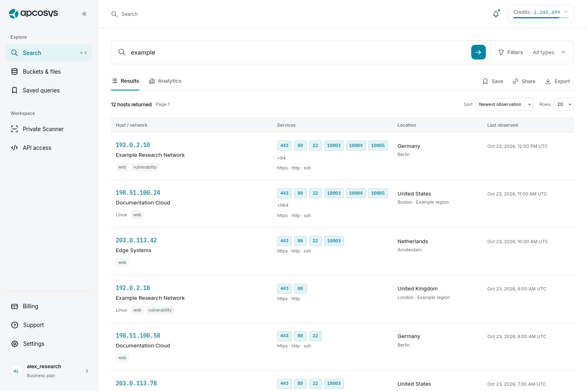
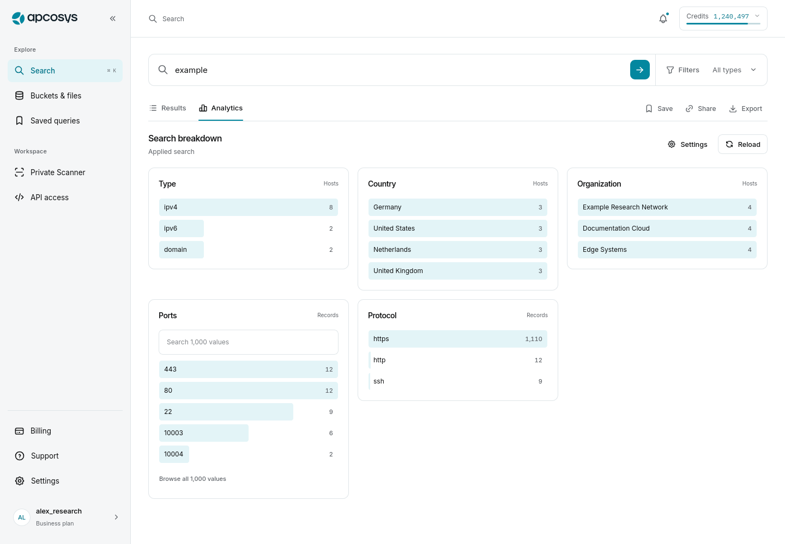
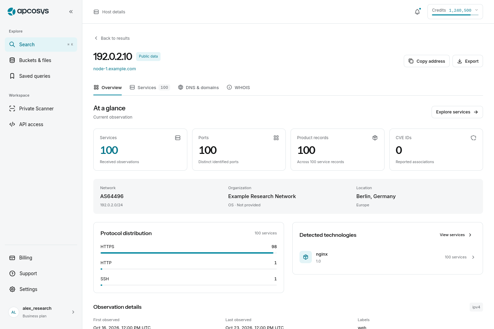
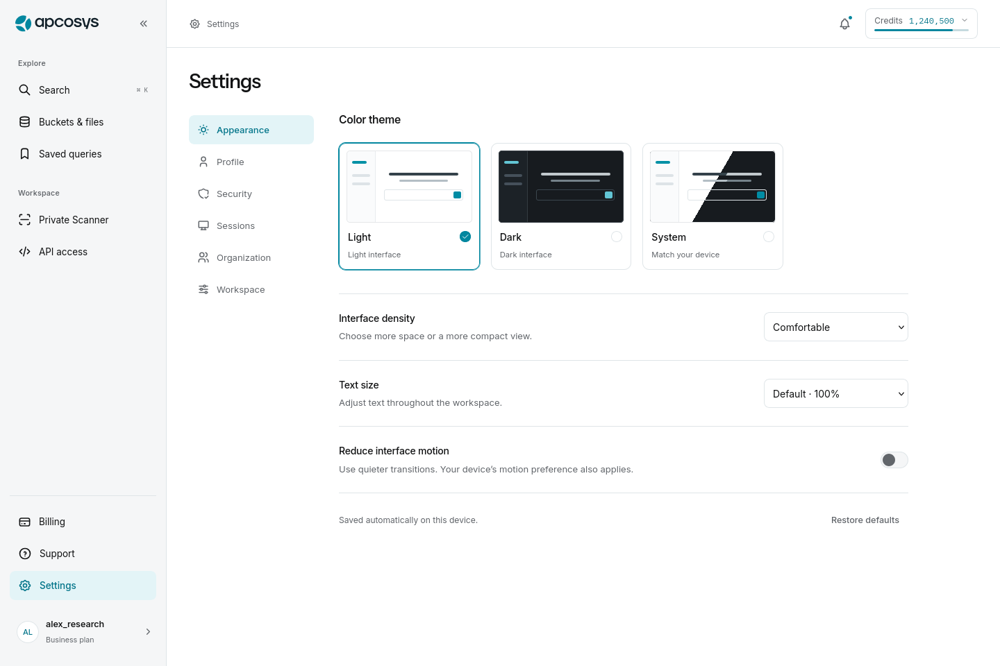

# APCOSYS — архитектура интерфейса и визуальный аудит

Дата: 24 октября 2026. База сравнения: `b4da7e225030fde720cdb586f8171e7afbc8ccdb`.

## Результат

Переработан фронтенд SaaS: общий каркас, структура рабочих страниц, вкладки, поиск и фильтры, настройки, уведомления, состояния загрузки и мобильные представления. Изменения реализованы в приложении, а не только в макетах. Старые URL и параметры сценариев сохранены там, где они уже являлись частью пользовательского контекста.

Публичная сборка использует прежний отдельный адаптер с данными в памяти. Внешние платежи, реальные сканы, почта и серверная авторизация не были подключены этой итерацией. Убраны видимые демонстрационные бейджи и пояснения реализации; конфигурация среды и интеграционные ограничения остаются явно описаны в README и технической документации. Live-режим по-прежнему не переключается на данные адаптера при сбое.

## Дизайн-основания

Изучены текущий опубликованный интерфейс, публичная оболочка и доступные без входа настройки ChatGPT, официальные описания организации чатов/проектов/файлов, а также предоставленная старая Figma SaaS. Закрытые страницы авторизованного аккаунта ChatGPT не использовались как проверенный источник.

В старой Figma просмотрены репрезентативные экраны поиска, выдачи и фасетов, хоста и HTTP, файлов, сканера, биллинга и мобильной навигации. Из них взяты принципы плотности, отделения инспектора от результата, типографики и осмысленных визуальных показателей. Интерфейс сохраняет бренд APCOSYS и техническую природу продукта.

- [Предоставленная Figma SaaS](https://www.figma.com/design/6RaLENxGqlpA6u3jGtKczc/Untitled?node-id=0-1).
- [ChatGPT: поиск чатов, проектов и файлов](https://help.openai.com/en/articles/10056348-finding-your-chats-projects-and-files-in-chatgpt).
- [ChatGPT: проекты](https://help.openai.com/en/articles/10169521-projects-in-chatgpt).
- [ChatGPT: работа с файлами](https://help.openai.com/en/articles/20001052-using-library-to-manage-files-in-chatgpt).
- [Официальные Tabler Icons](https://tabler.io/icons): единая система локально сохранённых SVG, с сохранённой лицензией.

## Структура продукта

| Область | Структура и результат |
|---|---|
| Общая навигация | Explore: Search, Buckets & files, Saved queries. Workspace: Private Scanner, API access. Нижняя зона: Billing, Support, Settings и профиль. В шапке — контекст страницы, уведомления и реальные доступные балансы. |
| Поиск | Встроенная строка запроса, тип результата и Filters. После поиска — отдельные Results и Analytics. Аналитика загружается явной командой, переключение вкладки само по себе не вызывает платный запрос. |
| Условия | Левый инспектор: основные параметры, вложенные AND/OR/NOT, даты, диапазоны, содержимое и расширенный JSON. Единый черновик, применение и отмена. Native UTC date controls используются только для точно представимых значений; сложные правила не переписываются. |
| Аналитика | Счётчики и полосы из фактически полученных значений; до трёх колонок на широком экране, две на среднем, одна на телефоне. Пять значений в компактном представлении, полный локальный поиск и ограниченные страницы по 50 значений. |
| Хост | Overview, Services, DNS & domains, WHOIS. В обзоре — факты хоста, доступность наблюдений, состав сервисов и технологии. В Services — отдельный каталог и выбранная запись. |
| Сервис | Response, TLS, Products & CVE, Data, Web files. У ответа — Banner, HTTP body, Headers; у web-файлов — Security.txt и Robots.txt. Полные исходные значения остаются доступны. |
| Files | Отдельная строка поиска и инспектор Content / Size / Dates / Advanced / Results. Files и Buckets используют свой контекст; смена представления не запускает запрос без действия пользователя. |
| Scanner | Tasks и Scheduled, затем All / Active / History. Поиск, статус, число строк, компактные карточки, отдельное окно деталей. Создание — Targets / Ports / Schedule и проверка оценки перед отправкой. |
| Billing | Overview, Plans, Credit packs, Payments, Crypto activity. Текущий план и баланс отделены от каталога тарифов и истории. Редактирование фильтра истории не сбрасывает платёжную операцию. |
| API access | API key и Usage & limits. Ключ закрыт по умолчанию, показ/копирование/ротация отделены от балансов и ограничений. |
| Settings | Appearance, Profile, Security, Sessions, Organization, Workspace. Вертикальные разделы на десктопе и прокручиваемые вкладки на телефоне. Выход из всех сессий перенесён в Profile и требует явного действия в диалоге. |
| Notifications | Группы по реальной дате, различимые непрочитанные записи, тематические иконки, переход к связанному разделу, отметка прочтения и URL-пагинация. |

## Поведение и состояния

### Сохранение работы пользователя

Черновики формы профиля сохраняются при переходе между разделами Settings и старыми `/account/*` маршрутами. Компоненты, содержащие незавершённую или неподтверждённую операцию, не уничтожаются обычным переключением вкладки. Старые вкладки хоста интерпретируются и переводятся в новую структуру без потери сервиса и вложенного представления.

Выбор сервиса на телефоне открывает только детальную область и переносит в неё фокус. Возврат показывает тот же отфильтрованный каталог. На десктопе предусмотрена стабильная высота рабочей области, чтобы короткая вкладка не сдвигала позицию чтения. Back восстанавливает поисковую строку, фильтры, страницу и позицию выдачи.

У вкладок связаны `tab` / `tabpanel`, работают стрелки, Home и End. Выбранный пункт раскрывается в пределах горизонтального списка без прокрутки всей страницы. Затухание края показывает продолжающийся список. Мобильное меню закрывается и при изменении query-раздела Settings, снимая блокировку основного содержимого.

### Ошибки и обратная связь

Обычные результаты операций, копирование и ошибки действий используют общие toast-уведомления с иконками. Ошибки полей остаются у соответствующих полей. Ошибка исходной загрузки и неизвестный исход изменения остаются в контексте, где пользователь может восстановить данные или проверить текущий статус. Неопределённый исход не превращается в успех и не открывает небезопасный повтор действия.

Начальная загрузка использует skeleton-композиции. Во время повторного запроса предыдущий результат сохраняется там, где это корректно; состояние обновления обозначается отдельно. У кнопок есть busy/disabled, у диалогов — Escape, ограничение фоновой прокрутки и возврат фокуса. Небольшие переходы учитывают системный reduced motion и настройку приложения.

### Достоверность показателей

- Ноль, неизвестное значение и неполный ответ не объединены в одно состояние.
- Счётчики относятся к реально полученным данным; локальная фильтрация не выдаётся за новый серверный поиск.
- Прогресс сканирования выводится только при наличии соответствующих величин. Отсутствующие счётчики не заменяются выдуманными процентами.
- Понятные подписи известных Cron-форм не заменяют исходное выражение. Неизвестное расписание остаётся Custom schedule.
- Неплатёжные sentinel-адреса и фиктивная сеть не предлагаются как инструкции для перевода. При отсутствии настроенного способа оплаты выводится доступное состояние недоступности сервиса.
- Фиктивная публичная CVE-ассоциация удалена из данных адаптера; подробности и большие списки CVE продолжают проверяться изолированными тестовыми ответами.
- Ключи, cookies, query payload и данные аккаунта не добавлены в постоянное клиентское хранилище. В localStorage остаются пользовательские настройки внешнего вида.

## Визуальные проходы и исправленные дефекты

Сначала просмотрены опубликованные основные страницы до изменений. После реализации проверялись реальные браузерные снимки рабочих вкладок и диалогов, затем повторно — места исправлений. Автоматические проверки размеров дополнялись просмотром изображений, а не заменяли его.

Среди исправленных проблем:

- смешанные наборы иконок, лишние бейджи и повторяющиеся служебные пояснения;
- две активные ссылки профиля/настроек и дублированный `aria-current`;
- сжатый блок фактов профиля на телефоне;
- слишком узкие тарифные карточки при ширине 820 px и тексте 125%;
- чрезмерная высота протокольного блока хоста и разреженная сетка аналитики;
- перенос последней буквы адреса/имени сервиса на отдельную строку;
- CSS-селекторы, случайно растягивавшие и обесцвечивавшие `span` иконок;
- потеря фокуса при переходе из каталога к сервису и из API key к Usage;
- дублированная скрытая форма редактирования сканера и повтор статуса задачи;
- недостаточный контраст активного прогресса и аватара;
- неверная структура списков уведомлений и повторное имя Conditions у двух вложенных областей;
- неполная ориентация мобильного tablist, отсутствие раскрытия выбранной вкладки;
- вывод неподдержанного поля поиска как технического сообщения о реализации адаптера;
- обрезанная кнопка удаления участника и слишком узкая колонка даты на телефоне — заменены компактным представлением строк;
- ошибка несовпадения паролей вне видимой области и неполная ширина Google sign-in — исправлены привязка к полю, фокус и ширина действия;
- возврат уже очищенного фильтра или потеря одного из условий при быстрых последовательных действиях в истории платежей, сканере и каталоге сервисов — обновления объединяются с текущими параметрами URL; проверены Back/Forward, переход в другой раздел Billing и сочетание основных и вложенных вкладок хоста;
- возврат старого запроса при переключении Results/Analytics или Files/Buckets сразу после отправки — смена вида сохраняет уже отправленные параметры и не создаёт дополнительный запрос;
- потеря клавиатурного фокуса после первой загрузки аналитики — фокус переходит к Reload только если пользователь не начал другое действие и остаётся на этой вкладке;
- кратковременное горизонтальное переполнение при переходе с десктопа на 320 px — мобильная рабочая область сразу освобождает место бокового меню без промежуточного анимированного отступа. Причина подтверждена кадрами Chrome-трассы; непосредственная проверка ширины остаётся без задержек;
- обрезанные выбранные значения Protocol и Contains в узком каталоге — фильтры располагаются на полную ширину; в более широком одноколоночном каталоге используются две колонки с отдельной строкой для порта. Проверены браузерные снимки на десктопе и 320 px.

## Проверка версии

| Проверка | Результат |
|---|---|
| TypeScript | PASS |
| Unit / transport / domain | 112/112 PASS, 15 файлов |
| Live build | PASS |
| Public review build | PASS |
| Chrome локально | **98/98 PASS**, полный прогон в Google Chrome 156 после исправлений всех подтверждённых потерь фильтров; после последней правки компоновки каталога — **10/10 PASS** и повторный визуальный сценарий |
| Firefox E2E | Полный прогон **90/90 PASS** и последующие целевые проверки изменений: **27/27**, **14/14**, **14/14**, **16/16 PASS**. Последний прогон включает Search/Files/Host и восстановление контекста. |
| Chrome CI / container smoke | Полный набор **98 сценариев**, включая проверки быстрых фильтров и смены вкладок; результат для каждой опубликованной версии — в [Actions](https://github.com/IMONsergey/Assaasdev/actions/workflows/ci.yml) |
| Опубликованный интерфейс | [APCOSYS](https://assaasdev.vercel.app/search); проверены Search, Analytics, Host, Billing и Settings после deployment |

Дополнительно просмотрены шесть состояний входа и восстановления на 1440/320 px и обе мобильные ошибки несовпадения паролей.

Полный браузерный набор проверяет основные маршруты при 1440, 390 и 320 px, промежуточные размеры 820/1024/1280, тёмную тему и текст 125%, клавиатуру, сохранение черновиков и контекста, крупные полученные наборы, экспорт, авторизацию, API и платёжные операции. Крупные наборы включают 1000 сервисов, 10 000 строк данных, 5000 фасетных значений, 1000 задач и 5000 платежей.

Axe выполняется для заданных страниц и состояний по WCAG 2 A/AA и 2.1 AA. Это конкретная автоматизированная проверка, а не полная сертификация доступности. Скриншоты и трассы находятся в browser-evidence CI; тестовые данные и перехваченные ответы не подменяют проверку реального backend.

## Граница готовности

Эта итерация завершает перестройку клиентского интерфейса и проверяемых пользовательских сценариев. Интеграционная приёмка реальных аккаунтов, email, OAuth/Telegram, платежей, прав доступа, расходования кредитов и сканирования остаётся отдельной задачей с существующим backend. Новые endpoints, база данных и платёжный провайдер не выдумывались.

Технические инструкции: [README](../../README.md), [API integration](../API-INTEGRATION.md), [deployment](../DEPLOYMENT.md).

## Снимки проверенного интерфейса

Снимки сделаны в браузере при локальной проверке этой реализации. На них используются данные отдельного адаптера и изолированных тестовых ответов, а не данные клиентского production backend.

### Поиск и аналитика

### Обзор хоста и настройки

### Мобильные сценарии

[Сканер: первая задача на начальном экране](2026-10-24-interface/scanner-mobile.png) · [Организация: участники и действия](2026-10-24-interface/organization-mobile.png).
